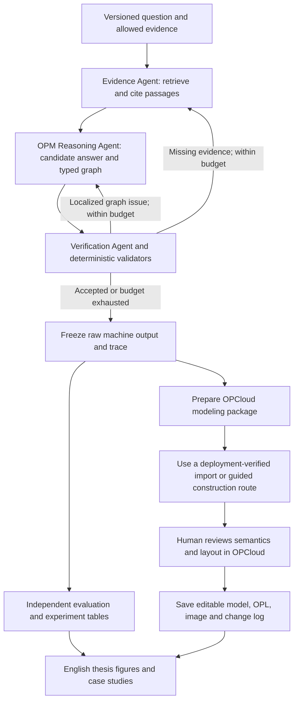

# OPM Medical QA — Master's Thesis

An English-language master's thesis project on evidence-grounded cardiology question answering with OPM-guided agents and a human-reviewed OPCloud modeling workflow.

**Working thesis title:** *An OPM-Guided Multi-Agent Framework for Evidence-Grounded Cardiology Question Answering*.

**Planning date:** 11 November 2026, Asia/Tokyo. **Target:** a complete English manuscript for supervisor review by **25 November 2026**. The fourteen execution days below run from 12–25 November; 11 November is the planning/setup day. The dates are a work plan, not a statement that experiments or integration are already complete.

Repository: [aiqishun/opm-medical-qa-thesis](https://github.com/aiqishun/opm-medical-qa-thesis). Source project: [opm-medical-qa](https://github.com/aiqishun/opm-medical-qa).

## 1. Current implementation and two-week scope

| Component | Current status |
| --- | --- |
| Independent thesis repository and preserved original project | Established; baseline tag `thesis-start-2026-11-11` |
| Rule-based topic matching, predefined answers/graphs, JSON/Mermaid export | Implemented in the inherited code |
| Existing tests | 287 passed locally at initialization; the initial GitHub Actions runs also passed |
| Existing MedQA task, schemas, labels, and evaluation tools | Included; its inherited data limitations remain documented |
| Evidence, reasoning, and verification agents | Proposed; not implemented yet |
| Evidence-linked graph contract and OPCloud handoff package | Proposed; not implemented yet |
| OPCloud account, native format, import path, and image export | Pending inspection in the user's actual deployment |
| New thesis experiments, results, and reviewed OPCloud figures | Pending |

The two-week core is one fixed model, three agent roles, a bounded repair loop, a small set of controlled comparisons, selected OPCloud models, and a complete English manuscript. Broader model sweeps, fine-tuning, reinforcement learning, clinical deployment, and a general-purpose OPCloud connector are stretch work outside this core.

## 2. Research question and intended contribution

**Research question:** Under comparable model and inference-budget conditions, does evidence-linked OPM construction and targeted verification improve explanation support and answer–graph consistency, while preserving useful answer accuracy?

The inherited reasoner selects a topic and returns its stored answer and graph. The thesis extension will investigate question-specific graph construction, evidence attribution, and localized correction. The intended contributions are an evidence-linked OPM representation, a bounded verification/repair mechanism, and controlled evaluation of their effects. These remain research hypotheses; the results must establish their value.

Medical multi-agent collaboration and graph-assisted reasoning already have substantial related work. Start with [MedAgents](https://aclanthology.org/2024.findings-acl.33/), [MedRAG/MIRAGE](https://aclanthology.org/2024.findings-acl.372/), [KACR](https://aclanthology.org/2025.emnlp-main.687/), and [GraphDx](https://aclanthology.org/2026.findings-acl.1092/). Define the contribution against these methods rather than treating agent count as novelty. Distinguish evidence support and consistency from stronger claims about internal reasoning, as discussed in the [faithful-explanation survey](https://aclanthology.org/2024.cl-2.6/).

## 3. End-to-end workflow



This is a workflow diagram for the README, not a formal Object-Process Diagram (OPD). Formal thesis OPDs will be created/reviewed in OPCloud.

Bulk experimental evaluation operates on frozen raw outputs. OPCloud is used for a selected set of reviewed system models and case diagrams; the batch evaluation must not depend on manually opening every question in a browser.

## 4. Agent responsibilities and interfaces

| Role | Inputs and tools | Required outputs |
| --- | --- | --- |
| Evidence Agent | Question, versioned corpus, retrieval tool | Tested concept, relevant question spans, source IDs, retrieved passages, evidence gaps |
| OPM Reasoning Agent | Question and allowed evidence | Selected option, concise explanation, objects/processes/states, typed relations, evidence references |
| Verification Agent | Candidate answer/graph, evidence, validation tools | Schema/structure findings, unsupported claims, case-applicability issues, answer–graph conflicts, localized repair requests |
| Deterministic controller | Agent state and budgets | Execution order, at most two repair rounds, stop reason, actual call/token/latency records |

Use one model version initially. Pin prompts and decoding settings. A separate model for every role is unnecessary for the initial study. The verifier combines programmatic checks with semantic review; neither a validator pass nor an agent's approval establishes medical correctness.

The word “Agent” in the software architecture does not automatically determine the corresponding formal OPM link type. Model each participant's role using the chosen OPM semantics during review.

## 5. Graph contract and OPCloud modeling package

The current `src/graph/exporter.py` writes a project-specific JSON graph. It is **not a verified OPCloud native file**. The current graph also represents states as labels without explicit owning-object IDs. Resolve ownership and typed semantics before conversion; do not infer ambiguous ownership solely from a label.

The proposed intermediate representation needs:

- Stable case, run, diagram, node, state, and relation IDs.
- Object/process types, state ownership, and explicit transition endpoints.
- A documented relation vocabulary with valid endpoint constraints.
- Evidence references, question applicability, and verifier findings.
- A selected answer linked to the graph elements that support it.
- Separate layout metadata, so positioning changes do not silently alter semantics.

For each selected case, the planned exporter will assemble:

```text
<case_id>/
  graph.raw.json          # Immutable machine output
  answer.raw.json         # Original selected option and explanation
  evidence.jsonl          # Source references and evidence spans
  verification.json      # Checks, repair attempts, unresolved issues
  elements.csv           # Proposed elements, stable IDs, state ownership
  relations.csv          # Proposed typed relations and evidence references
  candidate_opl.txt      # Human-reviewable OPL draft, not assumed importable
  modeling_steps.md      # Ordered construction and review instructions
  figure_metadata.json   # Run/commit IDs, hashes, figure ID, review status
```

These files and their exporter are planned deliverables, not currently available commands. Existing raw JSON must remain unchanged when the handoff package is created.

Begin OPCloud testing with a neutral model: **Document**, states **draft/reviewed**, and process **Reviewing**. Candidate review sentences are “Document can be draft or reviewed.” and “Reviewing changes Document from draft to reviewed.” They express the intended test semantics, not a claim that the deployment accepts pasted OPL.

## 6. Semi-automated OPCloud integration

### 6.1 Confirmed facts and open questions

The [official OPCloud site](https://www.opcloud.tech/) describes web-based collaborative OPM modeling, graphical/natural-language representations, and OPCAT backward compatibility. Its [features page](https://www.opcloud.tech/features) describes modeling, checking, and simulation. These statements do not establish that our JSON can be imported, that arbitrary OPL can generate a model, or that a public model-creation API is available.

An OPCloud-specific plugin was not returned by the available plugin-directory search on 11 November 2026. That search is not exhaustive; more integrations may be available in the [plugin directory](https://chatgpt.com/plugins). No authenticated OPCloud session has been inspected for this project.

| Capability to inspect in the actual account | Status |
| --- | --- |
| Create/save/reopen an editable model | Must be demonstrated in the deployment |
| Native model import/export format and version | Unverified |
| API for creating/editing models | No usable public contract established in this review |
| Editable OPL or text-to-model input | Unverified; generated OPL does not imply reverse conversion |
| Image/diagram export formats and scope | Unverified; inspect current export options |
| Browser automation availability in this environment | Not established; the earlier browser connection was unavailable |

### 6.2 Day-1/2 integration decision

1. Record the user's actual OPCloud URL, account/deployment, access rights, and available model menus. The user handles login and any MFA.
2. Create and save the neutral Document/Reviewing model in a new test workspace. Verify that it can be reopened without losing states or links.
3. Inspect the actual native export and import options. If a native editable file can be exported, use that small user-created file to establish the schema/version and permissible conversion route.
4. Test the chosen route on a duplicate model. Save, reopen, and compare element types, state ownership, endpoints, transitions, labels, and any generated OPL. Successful upload alone is not a successful semantic round trip.
5. Record supported image export formats and whether export covers a selected diagram or the whole model. Set a two-day time box; retain guided construction if no stable import route is established.

### 6.3 Route selection

| Route | When to use | Human checkpoint |
| --- | --- | --- |
| Documented API | Only after obtaining and testing a supported API contract for this deployment | Review a new test model before applying it to thesis cases |
| Verified native-file adapter | Only after a genuine exported sample and successful semantic round-trip test | Import into a separate model, inspect, then save/reopen |
| Guided UI construction | Default baseline while API/file compatibility is unresolved | Construct from the element/relation tables and review every ambiguous mapping |

The guided route is already semi-automated in design: the system prepares typed elements, evidence, candidate OPL, and ordered modeling actions; a human performs/reviews the OPCloud operations. If an enabled browser-control surface becomes available, repetitive visible UI actions may be assisted after the exact controls are observed. Human-guided steps remain the fallback.

OPCAT compatibility is a possible future route, not evidence that we can generate valid OPCAT files today. Do not fabricate native schemas, treat generic JSON as native, write directly to undocumented backend storage, or rely on unverified OPL paste behavior.

### 6.4 Human review and return to the repository

For each model, review object/process classification, state ownership, relation meaning, direction, evidence support, and applicability to the question. Record unresolved issues rather than silently completing a mechanism.

Save the editable model using the actual supported format and record its stable URL/identifier if available. Preserve OPCloud-generated OPL using an available export or reviewed text copy. Export SVG/PDF if supported; otherwise use the highest practical resolution PNG or an explicitly labeled screenshot fallback. Check labels and linework at final thesis size.

Proposed return artifacts:

```text
paper/figures/FIG03_case_<id>.<supported-image-extension>
paper/figures/FIG03_caption.md
models/opcloud/FIG03/                         # Exported editable source, if supported
models/opcloud/FIG03/opl.reviewed.txt
models/opcloud/FIG03/review_log.csv
models/opcloud/FIG03/figure_metadata.json
```

Record the native extension/format, deployment/version if visible, model ID, source commit, run/case IDs, raw-output hash, reviewer/date, and whether edits changed layout or meaning. Use a stable project figure ID when OPCloud does not expose stable element IDs.

## 7. Two distinct OPCloud model families

1. **System/method models:** a top-level OPD for the research system and a detailed OPD for verification/repair. These explain how the proposed system works.
2. **Question-specific mechanism models:** selected successful, repaired, and unresolved cases. These explain what the method produced for a question.

Start with four to six final OPDs: system overview, repair detail, a supported success case, a before/after repair pair, and an optional failure case. A before/after pair counts as two figures if presented separately. Freeze selection criteria before final diagram polishing and retain failures to explain limitations.

Semantic edits made in OPCloud are human assistance. Keep both the raw and reviewed versions. Quantitative claims about the automated method use raw outputs; a separate human-assisted analysis may evaluate the reviewed models and report editing time. Improving a paper figure must not retrospectively improve the automated system's score.

## 8. Data and experiment protocol

The inherited dev/test task has 12 duplicate questions across splits and two conflicting cardiology labels; see [the data audit](docs/DATA_AUDIT.md). Preserve the original files, adjudicate conflicts with documented evidence, and create versioned partitions using original identities and content-based duplicate groups. The existing `qNNNN` strings are not global IDs across candidate lists.

Use already inspected examples for development. Freeze a held-out evaluation set, evidence corpus, prompts, and evaluation rules before final experiments. Keep gold labels and question-solution pages out of agent inputs and retrieval. Preventing project-level leakage does not establish that public questions were absent from a model's pretraining.

Minimum controlled comparisons:

| Condition | Purpose |
| --- | --- |
| Single-agent evidence QA with textual explanation | Basic evidence-grounded baseline |
| Single-agent evidence QA with OPM construction/checking | Test the representation under similar tools and budget |
| Three-agent OPM system with verification/repair | Test role separation and targeted correction |
| Full system without verification/repair, if budget permits | Attribute correction benefit and measure saved compute |

Keep the backbone model and allowed evidence comparable. For attribution experiments, hold retrieved passages fixed; adaptive retrieval can be a separate analysis. Report actual calls/tokens/time and budget-matched comparisons. The inherited rule-based method remains a reference; report answer-option accuracy for it only if a valid answer-option interface is defined.

Measure answer-option accuracy, supported relation/claim rate, explanation completeness, answer–graph consistency, repair success and regressions, structural validity, latency, and token usage. Include coverage/completeness so deleting difficult relations cannot trivially improve support precision. Keep cardiology-screening F1 separate from QA accuracy. Count abstentions, invalid records, and missing predictions explicitly.

Use independent human review of a prespecified sample, preferably with two suitably qualified reviewers. If this is unavailable, document the actual reviewer qualifications and limits; do not claim expert or inter-rater validation that did not occur. The producing verifier is not the independent evaluator. Report uncertainty and avoid interpreting a small pilot as a conclusive performance study.

## 9. Fourteen-day execution plan

| Day / date (JST) | Main work | Deliverable / checkpoint |
| --- | --- | --- |
| Planning — 11 Nov | Agree scope; inspect existing code; prepare this README | Current plan and open integration questions |
| 1 — 12 Nov | Confirm supervisor format, model budget, OPCloud URL/access; start data audit | Written protocol, account capability notes, English thesis outline |
| 2 — 13 Nov | Resolve or quarantine conflicts; freeze pilot data; test neutral OPCloud model and round trip | Versioned data manifest and a verified OPCloud route; guided route if import unresolved |
| 3 — 14 Nov | Implement single-agent evidence baseline and contracts | Reproducible command, complete raw records and traces |
| 4 — 15 Nov | Add three roles, controller, validators, bounded repair | End-to-end development pilot; record failures |
| 5 — 16 Nov | Fix pilot defects; choose final sample size from data/review/budget constraints | Frozen model, prompts, corpus, evaluation protocol and configurations |
| 6 — 17 Nov | Run primary comparisons | Raw predictions, costs, missing/error records |
| 7 — 18 Nov | Complete main runs and affordable ablation/repeats | Experiment matrix and preliminary tables |
| 8 — 19 Nov | Independent review, paired comparisons, uncertainty/error analysis | Final result tables and case-selection record |
| 9 — 20 Nov | Build/review system OPDs and selected case OPDs in OPCloud | Editable models, exported images, OPL and change logs |
| 10 — 21 Nov | Complete English Methods and Experimental Setup | Chapters matching actual implementation |
| 11 — 22 Nov | Complete Results, Error Analysis and Discussion | Evidence-based interpretation, including negative results |
| 12 — 23 Nov | Complete Introduction, Related Work, Abstract and Conclusion | Complete English manuscript v1; early chapters should already be drafted |
| 13 — 24 Nov | Supervisor/self-review; check citations, figures, reproducibility and inherited/new-work boundaries | Revised manuscript and final figure manifest |
| 14 — 25 Nov | Address final issues; render and inspect the required thesis format; archive | Complete English manuscript and traceable experiment/model package |

Write and maintain references daily from Day 1. Do not postpone all writing until experiments finish. If native OPCloud automation is unresolved on Day 2, use guided construction; if experimentation expands, cut optional models/ablations before sacrificing reproducibility or inventing results. Report an inconclusive or negative finding honestly.

## 10. Figure and evidence inventory

| Figure ID | Content | Source and treatment |
| --- | --- | --- |
| FIG01 | System-level OPM workflow | Human-reviewed OPCloud system model |
| FIG02 | Verification and repair detail | Human-reviewed OPCloud detail model |
| FIG03 | Evidence-supported success case | Raw output plus separately tracked OPCloud review |
| FIG04–05 | Before/after repair | Preserve actual machine versions and any later human edits |
| FIG06, optional | Unresolved failure | Document why repair or evidence was insufficient |
| Additional charts | Accuracy, support, repair, time/token comparisons | Generated from frozen experiment outputs with plotting scripts |

Maintain one figure manifest linking each image/caption to the source model, commit, run, case and review record. OPCloud diagrams and numerical charts serve different purposes and should be generated by the appropriate tools.

## 11. Run the existing baseline now

These commands refer to code that exists today. They do not run the proposed agents or connect to OPCloud.

```bash
python3 -m venv .venv
source .venv/bin/activate
python -m pip install -r requirements-dev.txt
python -m pytest -q
python scripts/run_qa.py --question "What causes myocardial infarction?"
python scripts/run_qa.py --question "What causes myocardial infarction?" --export-graph outputs/graphs/baseline_demo.json
python run_inference.py --dry-run
```

The last command checks the inherited 100-question inference mapping without calling a model. The QA demo uses the existing topic knowledge base; it is not a new thesis result. Optional model calls use environment credentials; keep them outside version control.

## 12. Repository map and implementation backlog

| Path | Purpose |
| --- | --- |
| `src/`, `scripts/`, `tests/` | Existing implementation and future thesis extensions |
| `data/`, `annotations/` | Knowledge/sample data, contracts and inherited annotation material |
| `medqa_opm_task/` | Existing task, evaluator references and historical traces; observe its participant/evaluator separation |
| `experiments/`, `outputs/` | New experiment artifacts; generated results are currently ignored by default |
| `paper/` | English thesis source and figures |
| `models/opcloud/` | Proposed location for reviewed editable models and associated review records |
| `references/conference/` | Inherited papers/reports; exact correspondence to the final published version still needs checking |
| `docs/` | Origin, data audit and initial planning records |

Planned implementation tasks, in dependency order:

- [ ] Confirm account access, model/API budget, manuscript template and review support.
- [ ] Version the audited data and pilot/evaluation partitions.
- [ ] Define and validate evidence-linked graph and agent-output contracts.
- [ ] Implement the single-agent evidence baseline.
- [ ] Implement evidence/reasoning/verification roles and the bounded controller.
- [ ] Implement OPCloud handoff-package generation.
- [ ] Demonstrate the neutral model's save/reopen and any import/export route.
- [ ] Freeze and run comparisons; complete independent evaluation.
- [ ] Complete selected OPCloud OPDs, captions and figure provenance.
- [ ] Complete and render the English thesis.

The current `.gitignore` excludes generated output trees. Preserve the actual experiment artifacts in a deliberate versioned results location or reproducible external archive and commit its manifest/checksums. Do not rely on ignored local files as the only copy of thesis evidence. Small final figures/native models can be tracked where appropriate; model files containing credentials or deployment-specific private metadata must be sanitized first.

## 13. Thesis structure and provenance

1. Introduction
2. Background and Related Work
3. Problem Definition and Data Protocol
4. Proposed OPM Representation and Agent Method
5. Experimental Setup
6. Results and Ablations
7. Error Analysis, Discussion and Limitations
8. Conclusion

Clearly identify inherited methods and results, then state which components and experiments were added for the thesis. Cite the published conference paper once its final bibliographic record and experimental version are established. A polished diagram does not establish answer correctness or full OPM conformance.

Supporting records: [project origin](docs/PROJECT_ORIGIN.md), [data audit](docs/DATA_AUDIT.md), [initial migration checklist](docs/THESIS_PLAN.md), [initialization validation](docs/MIGRATION_VALIDATION.md), and [inherited conference materials](references/conference/README.md).

This repository is a research prototype. MedQA notices are in `medqa_opm_task/reference/`; no separate task/software license has been assigned. Research outputs are not clinical diagnosis or treatment recommendations.
